# Census Block Group Clustering Algorithm

Groups 2020 Census Block Groups (BGs) into neighborhood types with k-means. A national
feature matrix (50 states + DC, index = 12-char `GEOID`) describes neighborhood character
(location, demographics, housing, schools, crime, taxes, occupations); it is standardized,
weighted so every concept counts equally, and clustered for any set of states.
`kmeans_formulation.tex` (compiled: `kmeans_formulation.pdf`) states the exact objective and
distance.

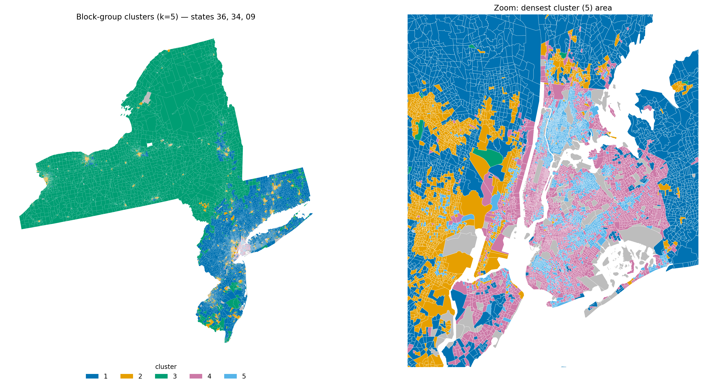

## Layout

```
common.py                 shared config/helpers (paths, ACS fetch, GEOID contract)
features/<name>.py        one module per source; build() -> raw DataFrame, __main__ writes interim
standardize.py            merge + select + transform + impute + scale (final step; importable transform())
run_pipeline.py           runs every feature module (if needed) then standardize
cluster.py                k-means for chosen states -> outputs/cluster_<states>_k<k>/
kmeans_formulation.tex/.pdf   mathematical statement of the full method
examples/                 three worked examples (below)
data/raw/<name>/          cached downloads (reruns are offline)
data/interim/<name>.parquet   raw per-module features (239,741 BGs)
data/processed/           outputs below
```

`data/processed/`: `features_raw.parquet` (all interim columns, all rows, untouched),
`features_standardized.parquet` (clustering matrix), `features_weighted.parquet` (x group
weights), `missing_mask.parquet` (True = imputed), `feature_metadata.csv`,
`scaler_params.json` + `imputation_medians.parquet` (to re-apply the transform),
`excluded_block_groups.csv`. `data/` is not in the repository (~1.6 GB); the pipeline
downloads every source from its public URL. SEDA's terms forbid redistributing its raw files.

## Run

```
pip install -r requirements.txt
```

```
python run_pipeline.py                  # reuse existing interim files, then standardize (~30 s)
python run_pipeline.py --force          # rebuild everything (downloads; slow)
python run_pipeline.py --force crime    # rebuild one module
```
Set `CENSUS_API_KEY` for ACS rebuilds. To apply the fitted transform to new/edited data:
`from standardize import transform; Z = transform(raw_df)` (same columns as `features_raw`).

Clustering (details in the `cluster.py` docstring):
```
python cluster.py --states 36 34 09 --k 5        # state FIPS codes; ~15 s
python cluster.py --states 06 --k 15 --zoom bay_area los_angeles --out examples/california_k15
```
Writes `assignments.csv`, `profile.csv` (per-cluster medians), `centroids_z.csv` and `map.png`
(BGs not clustered in gray) to `outputs/cluster_<states>_k<k>/` or `--out`. The map has one
zoom panel per `--zoom` region (`nyc`, `chicago`, `bay_area`, `los_angeles`, `houston`, `dfw`,
`atlanta`, `washington_dc`, `philadelphia`, `miami`, `phoenix`, or the group `top10_metros`;
add more in `cluster.ZOOMS`), or one around the densest cluster by default. `--states conus`
selects the 48 contiguous states + DC. Block-group shapes
are clipped to the shoreline (Census 1:500k county boundaries, downloaded once), because
TIGER/Line block groups include their water area and would otherwise reach across bays. Clusters 1-7 use the
colorblind-safe Okabe-Ito colors; no palette keeps more than about 7 categories reliably
distinguishable, so for k > 7 `map_by_cluster.png` also shows each cluster in its own panel.
By default features are re-standardized within the selected states (`--scale regional`).
`--overview-4k` also writes `map_4k.png`, the overview alone at 3840 x 2160.

**Caching.** Each state's shoreline-clipped block-group shapes are cached in
`data/cache/bg_shapes/` the first time they are drawn (rebuilt automatically if the source
files change). Every run also writes `run_info.json` (states, k, seed, scale, scikit-learn
version and a hash of the feature files); with `--reuse`, a rerun into the same `--out` folder
loads `assignments.csv` instead of refitting k-means when all of these match, and refits
otherwise. For the contiguous US, loading all shapes from the cache takes ~6 s (vs. several
minutes of reading and clipping), and a full `--reuse` re-render of the example (overview +
10 zooms, per-cluster map and a 4K overview) took ~3.5 min, almost all of it drawing 235,000 polygons;
the first run took ~11 min. The national cache is ~1.1 GB, all under `data/` (not in git).

## Examples

Each folder in `examples/` holds the full outputs of one run.

### Contiguous US, k = 15 (zooms: 10 largest metro areas)

`examples/conus_k15/` - 48 states + DC, 235,304 block groups, silhouette 0.082. Zoom panels:
New York, Los Angeles, Chicago, Dallas-Fort Worth, Houston, Atlanta, Washington, Philadelphia,
Miami and Phoenix (largest metro areas by 2023 population).

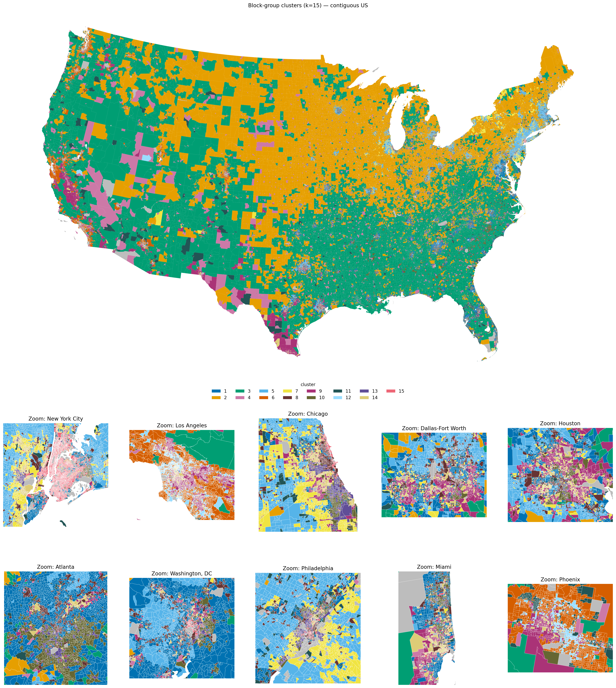
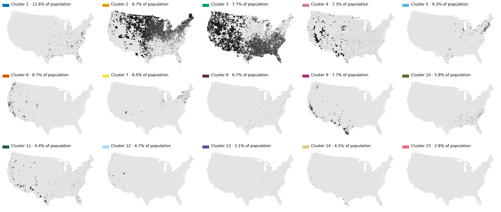

Some patterns, from `profile.csv` (medians per cluster):
- Rural areas split mostly by location: cluster 2 (Northern Plains, Midwest, Northeast) and
  cluster 3 (South and interior West), each under 30 people/km².
- Suburbs split by income and region: clusters 5 ($148k) and 6 ($131k, mostly West) vs.
  cluster 1 ($109k).
- Mostly Hispanic neighborhoods form clusters 9 (69% Hispanic, mostly owners) and 14
  (71%, mostly renters); mostly Black neighborhoods form 10 (53%) and 13 (58%, lower income).
- Cluster 15 is dense high-rise neighborhoods (19,000 people/km², 51% of homes in 20+ unit
  buildings, 37-minute median commute): 74% of its block groups are in New York, the rest
  mainly in Boston, Chicago and Washington.
```
python cluster.py --states conus --k 15 --zoom top10_metros --out examples/conus_k15   # ~11 min
```

### Contiguous US, k = 25 (zooms: 10 largest metro areas)

`examples/conus_k25/` - same block groups and zooms as above with 25 clusters, silhouette
0.074 (vs. 0.082 at k = 15). Colors 16-25 extend the palette; with 25 categories several
pairs are hard to tell apart, so use `map_by_cluster.png` to identify a cluster.

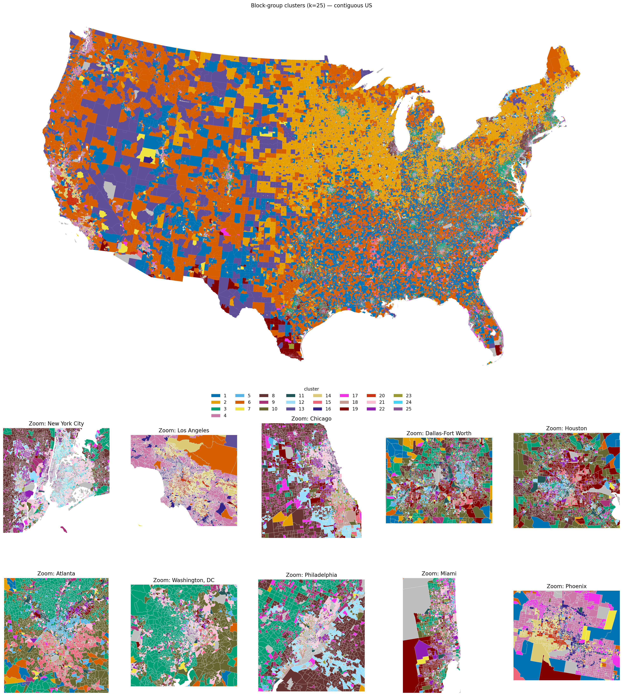
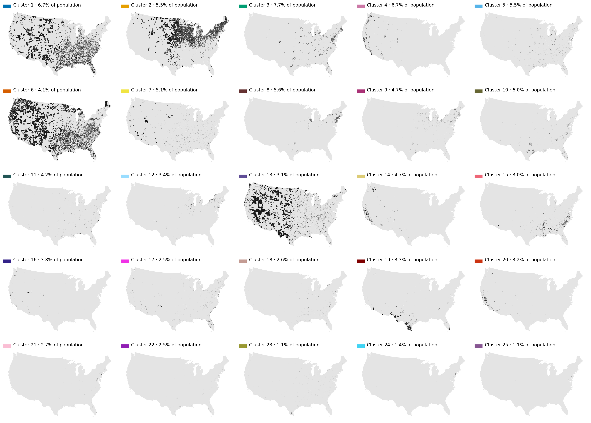
```
python cluster.py --states conus --k 25 --zoom top10_metros --out examples/conus_k25   # ~9 min with cached shapes
```

### New York metro (NY, NJ, CT), k = 5

`examples/ny-nj-ct_k5/` - 24,680 block groups, silhouette 0.151. Medians per cluster:

| Cluster | Share of pop. | Density (/km²) | Median HH income | Renters | Single-family detached | Median commute (min) | Character |
|---|---|---|---|---|---|---|---|
| 1 | 36% | 1,055 | $138,600 | 10% | 89% | 28 | Affluent suburbs |
| 2 | 19% | 3,446 | $62,900 | 63% | 26% | 21 | Small cities and older inner suburbs |
| 3 | 16% | 183 | $76,300 | 18% | 76% | 21 | Upstate towns and rural areas |
| 4 | 16% | 14,714 | $107,200 | 54% | 4% | 38 | Middle- and upper-income NYC neighborhoods |
| 5 | 13% | 24,618 | $54,400 | 89% | 0% | 43 | Dense, lower-income, mostly renter NYC neighborhoods |

The right panel of the map zooms on New York City.
```
python cluster.py --states 36 34 09 --k 5 --out examples/ny-nj-ct_k5
```

### Pennsylvania, Ohio, Indiana, Illinois, k = 15 (zoom: Chicago)

`examples/pa-oh-in-il_k15/` - 34,498 block groups, silhouette 0.086.

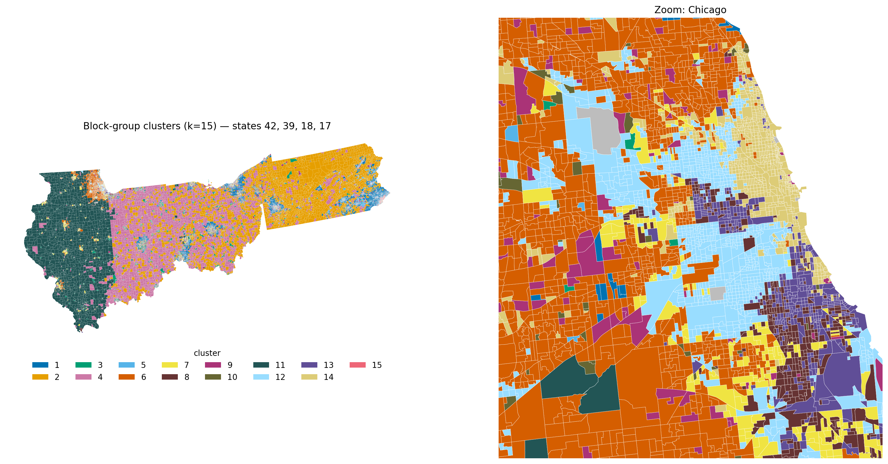
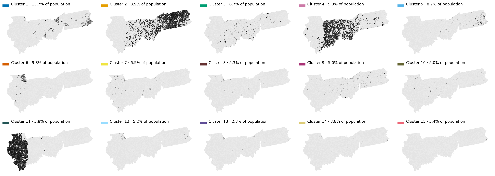

Rural and small-town areas split largely along state lines (cluster 11 is almost all of rural
Illinois; clusters 2 and 4 cover rural Pennsylvania and Indiana/western Ohio). Between rural
Illinois and Indiana, property tax accounts for ~78% of the weighted feature gap (Illinois
rates are far higher); between Indiana and Pennsylvania, physical distance accounts for ~67%
and property tax ~18%. The tax difference is real, but it makes clusters follow state lines.
```
python cluster.py --states 42 39 18 17 --k 15 --zoom chicago --out examples/pa-oh-in-il_k15
```

### California, k = 15 (zooms: Bay Area, Los Angeles)

`examples/california_k15/` - 25,446 block groups, silhouette 0.090.

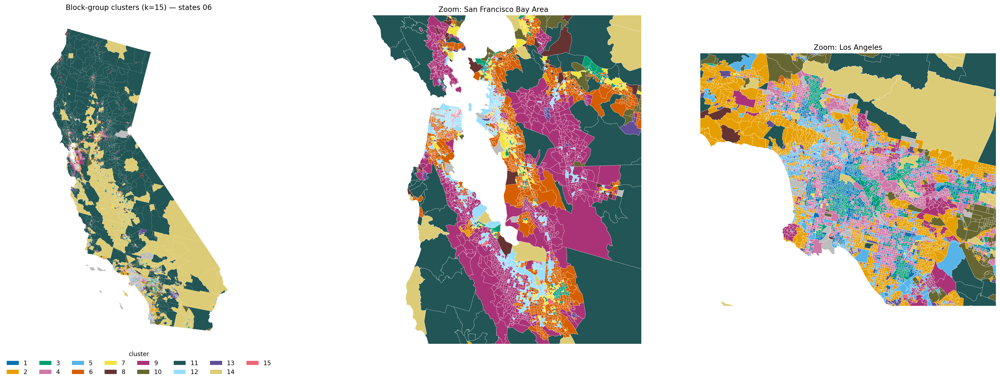
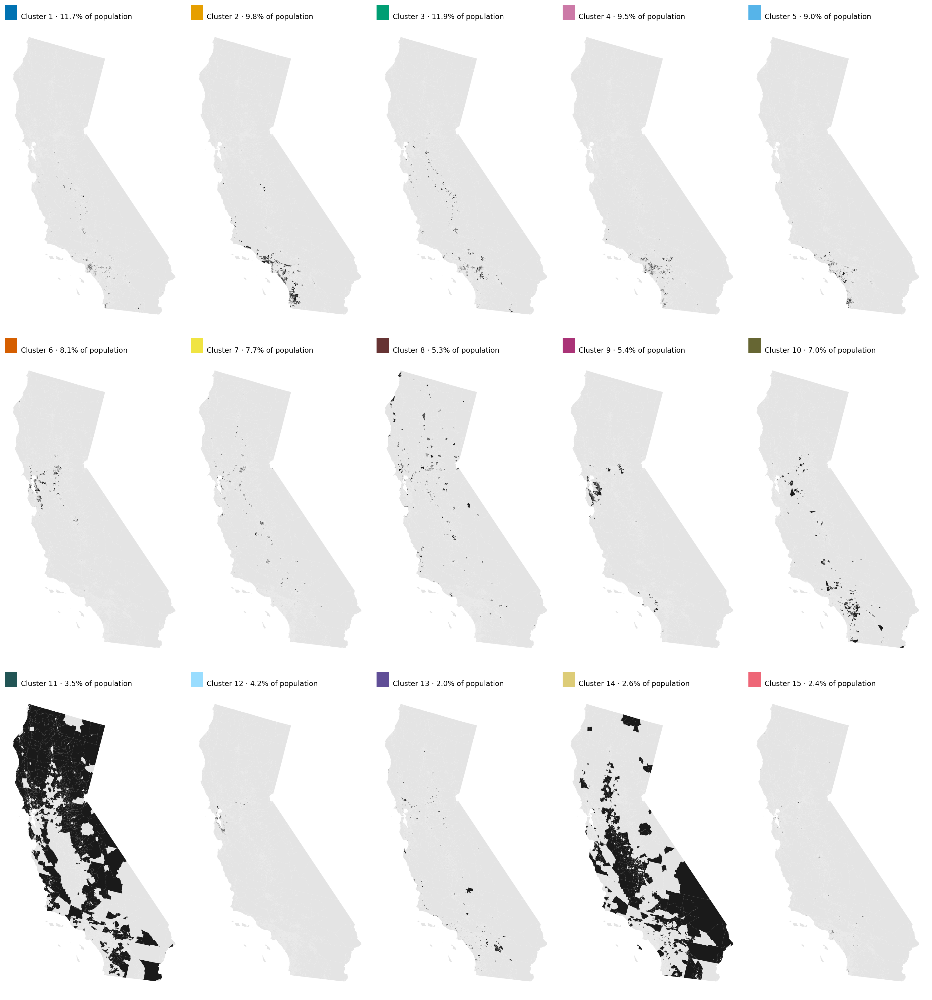
```
python cluster.py --states 06 --k 15 --zoom bay_area los_angeles --out examples/california_k15
```

### Texas, k = 15 (zooms: Houston, Dallas-Fort Worth)

`examples/texas_k15/` - 18,441 block groups, silhouette 0.090.

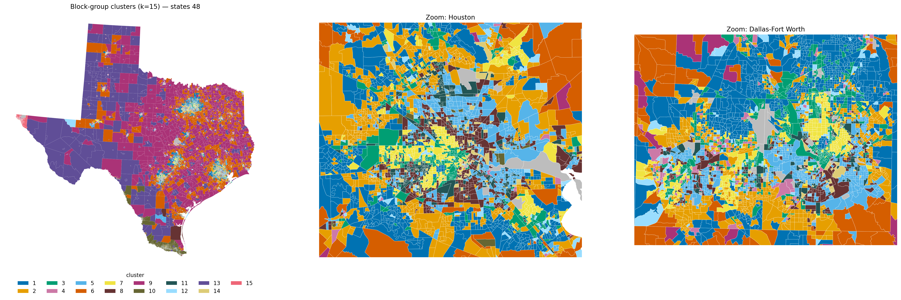
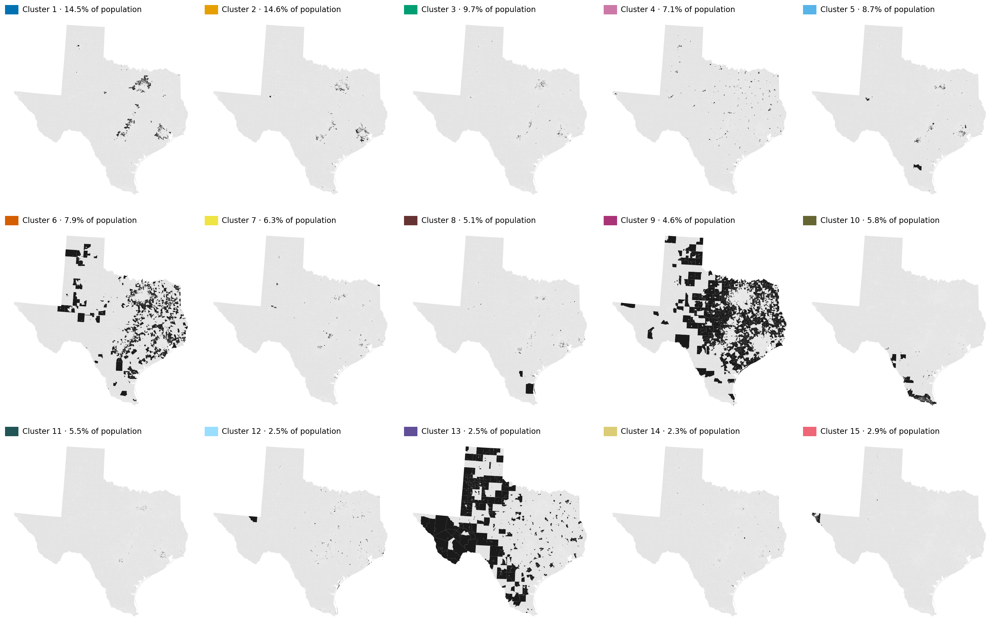
```
python cluster.py --states 48 --k 15 --zoom houston dfw --out examples/texas_k15
```

## Features (default selection)

| Concept | Columns | Source | Native geography | Caveat |
|---|---|---|---|---|
| Physical distance | `ecef_x_km`, `ecef_y_km`, `ecef_z_km` | CenPop2020 BG pop-weighted centers (TIGER internal point fallback) | BG | Fallback point for ~0.6% of BGs |
| Racial composition | 7 `race_*_share` (NH white/black/AIAN/Asian/NHPI/other+multi, Hispanic) | ACS 2019-23 B03002 | BG | Small groups (AIAN, NHPI) are rare; pooled block scale keeps their z bounded (see Scaling) |
| Population density | `pop_density_per_sqkm` | ACS B01003 / TIGER ALAND | BG | |
| Languages spoken | 5 `lang_tract_*_share`, `lep_hh_share` | ACS C16001 (tract), C16002 (BG) | tract / BG | Language mix is tract-level, broadcast to BGs |
| Median age | `median_age` | ACS B01002 | BG | |
| Median income | `median_hh_income` | ACS B19013 | BG | Top-coded at $250,001; ~6% missing (imputed) |
| Dependents / household | `hh_with_children_share`, `avg_hh_size`, `age_dependency_ratio` | ACS B11005, B25010, B01001 | BG | Ratios blow up in tiny BGs (winsorized) |
| Home type | 6 `units_*_share` | ACS B25024 | BG | Denominator includes vacant units |
| Rent vs buy | `renter_share` | ACS B25003 | BG | |
| Cars owned | `zero_vehicle_hh_share`, `mean_vehicles_per_hh` | ACS B25044 | BG | "5+" counted as 5 |
| Commute time | `median_commute_min` | ACS B08303 (binned, interpolated) | BG | Excludes work-from-home |
| Education quality | `school_quality_index` (SEDA), `hud_school_proficiency_index` | SEDA 6.0 / 2025.2; HUD AFFH (2015-16) | school district / attendance zone | See limitations |
| Crime rate | `violent_crime_rate`, `property_crime_rate` | FBI CDE 2025 (+ CHR 2022 fallback) | city / county remainder | See limitations |
| Property tax | `eff_property_tax_rate_tract` | ACS B25090/B25082 | tract | Not published at BG |
| Occupation composition | 5 `occ_*_share` (mgmt/business/science/arts, service, sales/office, construction/maintenance, production/transportation) | ACS C24010 | BG | Residents' occupations, not local jobs; noisy in small BGs |

In `features_raw` but off by default (toggle in `standardize.FEATURES`): `seda_avg_2022_2025`
(no data for AK, AR, CO, ME, NY, OR), `adult_ba_plus_share` (attainment, not school quality).
Never selected: metadata/duplicates/denominators (`lat`, `lon`, `x_m`, `y_m`,
`coord_is_fallback`, `aland_sqkm`, `awater_sqkm`, `population`, `seda_avg_2009_2019`(+`_se`),
`crime_geo_level`, `crime_source`, `employed_civ_16plus`).

**Optional enrichment:** `data/interim/building_footprints.parquet` (Microsoft footprints:
building count/density/coverage/mean size) exists for Delaware only and is not merged. A
national run (`python features/building_footprints.py all`) takes ~2.5 h and downloads ~4.8 GB.

## Standardization (details in the `standardize.py` docstring)

1. **Rows:** drop BGs with population < 50 or zero households (2,912 of 239,741; listed in
   `excluded_block_groups.csv`). Below 50 people, 88-100% lack income and ratios explode.
2. **Transforms:** `log1p` for density and income; winsorize at the 0.5/99.5 percentiles for
   `avg_hh_size`, `mean_vehicles_per_hh`, property tax; winsorize + `log1p` for age dependency,
   commute and crime (violent crime floored at the 2nd percentile because zero-crime
   small agencies would otherwise become extreme outliers). Shares and ECEF are untouched.
3. **Imputation:** median of the transformed value in the same tract, else county, else
   state, else nation. Race, units, language and occupation shares are imputed together and
   rescaled to sum to 1.
4. **Scaling:** z-score per feature, except pooled-scale blocks whose columns share one sd
   (`scale_block` in `feature_metadata.csv`): ECEF x/y/z (862 km) so distances stay
   geometrically true, and each compositional share block (race, home type, language mix,
   occupation; `POOL_SHARE_BLOCKS`) so one percentage point counts the same in every
   category. Per-column z-scoring had divided rare shares by tiny sds (NHPI: 1 pp = 2.1 sd,
   max z ~67 nationally), letting a few BGs dominate distances. `cluster.py`'s regional
   re-scaling pools the same blocks.
5. **Weights** (`features_weighted`): column weight = `CONCEPT_WEIGHTS[group] / sqrt(n_cols)`,
   so every concept contributes equal variance; edit `CONCEPT_WEIGHTS` to emphasize one.

## Known limitations

- **Coarse geography:** property tax and language mix are tract-level; crime is
  jurisdiction-level (every BG in a city or county remainder shares a value); SEDA is
  school-district-level (all BGs of a large district are identical). Clusters can partly
  reflect those boundaries.
- **Crime:** incomplete agency reporting (FL/ND limited, NIBRS transition), state-police
  offenses omitted, commercial enclaves have extreme property rates (winsorized).
- **SEDA terms:** non-commercial use only, cite SEDA, do not redistribute raw files.
  Scores reflect achievement (SES-confounded), not school value-added.
- **HUD school index:** 2015-16 data, state-relative proficiency (not comparable across states),
  missing for AK/ME/KS/DE (imputed).
- **State borders:** in multi-state runs, features that jump at state lines (above all
  property tax rates; also crime reporting and the state-relative HUD school index) can make
  clusters follow state lines - see the PA-OH-IN-IL example.
- **Universe:** 40 TIGER BGs (Suffolk Co., NY + one Ulster Co. BG) are absent from ACS 2023
  and from every output.
- **Footprints:** only run for Delaware (see above).
